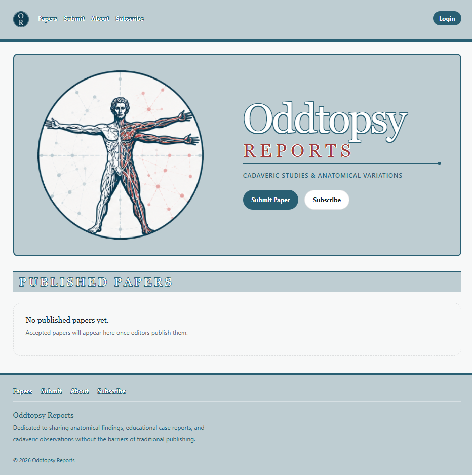

# Oddtopsy Reports

Oddtopsy Reports is a peer-reviewed digital journal for anatomical pathology and cadaveric education. It provides a modern submission and editorial workflow for case reports, including rich-text authoring, PDF uploads, editorial review, author revisions, revision history, and publication.

Built with:

- Next.js 16
- Payload CMS 3
- PostgreSQL
- Amazon Cognito (production sign-in), Amazon SES (email), Amazon S3 (media)
- Docker
- TypeScript

---

## Screenshots

### Homepage



## Design Goals

Oddtopsy Reports was designed as a lightweight alternative to traditional academic publishing platforms. The focus is on:

- streamlined editorial workflows
- long-term maintainability
- clean separation between author and editor experiences
- modern responsive UI
- minimal administrative overhead

## Features

### Authors (no account needed)

- Submit manuscripts as a PDF upload or written in the editor
- Upload featured and supporting images
- Receive a submission receipt by email
- Revise a submission through a private, time-limited link when the editors request revisions
- Receive an email when the paper is published

### Editorial

- Request Access workflow: applicants ask for an account; managers and admins approve (Editor or Manager) or reject
- Roles: Editor, Manager, Admin, each with an account status (Invited, Active, Disabled)
- Shared editorial queue, preview and edit modes, version history
- Request Revisions, Approve & Publish, Unpublish, Trash
- User management: approve, change roles, disable, resend invites, delete (admins)
- Email notifications for every workflow step (see [docs/notifications.md](docs/notifications.md))

### Public Site

- Homepage, featured papers, papers archive
- Article pages at readable URLs (`/articles/<slug>`); old numeric URLs redirect
- Sitemap and robots.txt
- Responsive design

---

## Authentication

Sign-in methods are chosen by the `AUTH_PROVIDERS` environment variable, not by `NODE_ENV`.
Payload always owns user records, roles, account status and permissions.

| Environment | `AUTH_PROVIDERS` | Sign-in |
|---|---|---|
| Local development | `password` (default) | Payload email and password. No AWS needed. |
| Production | `cognito` | Amazon Cognito managed login at `auth.oddtopsies.org`, with required email MFA. Payload password login and reset endpoints are disabled. |

`password,cognito` enables both (used only during the migration to Cognito).

- Accounts are only created by approving an access request. In production, approval creates the Cognito user, stores its `sub` on the Payload user and Cognito emails the invitation; users are never linked by email.
- Only **active** users have editorial access. `/admin` (Payload Admin) is limited to active admins, and in production to Cognito-authenticated admins.
- There is always at least one active admin: the last one cannot be demoted, disabled or deleted. Nobody can change their own role or status.
- Deleting a user removes their Cognito account (by `sub`) before the Payload record; history such as notes and decisions is kept.

---

## Development

### Requirements

- Docker Desktop
- Node 22 and pnpm 10 (for tests and scripts on the host)

### Local Setup

```bash
git clone <repo>
cd oddtopsy-reports
cp .env.example .env      # local defaults: AUTH_PROVIDERS=password
docker compose up --build
```

After the application starts:

```bash
docker compose exec payload pnpm seed:focus-areas
docker compose exec payload pnpm create:admin   # uses ADMIN_EMAIL / ADMIN_PASSWORD from .env
```

Visit `http://localhost:3000`. Locally, emails are printed to the app log (`docker compose logs -f payload`) unless `EMAIL_FROM_ADDRESS` is set, in which case they are sent through SES.

---

## Scripts and Tests

```bash
pnpm dev                 # Next.js dev server
pnpm build               # production build
pnpm generate:types      # regenerate src/payload-types.ts after schema changes
pnpm payload migrate:create <name>   # create a migration after schema changes
pnpm test:int            # unit / integration tests (Vitest, offline)
pnpm test:smoke          # end-to-end smoke test against the local Docker stack
pnpm seed:focus-areas
pnpm create:admin
```

Operational scripts (run inside the container or as one-off ECS tasks):

- `tsx src/scripts/sendTestEmail.ts [address]`: sends a test email through the app's SES path
- `tsx src/scripts/clearLegacyPasswords.ts`: clears stored Payload passwords and sessions; refuses to run while password sign-in is enabled

---

## Project Structure

```
src/
    access/          role, account-status and visibility rules
    app/             Next.js routes (frontend, Payload admin, auth, API)
    collections/     Payload collections
    components/      shared and Payload-admin components
    lib/             auth, email, notifications, submissions, slugs, ...
    migrations/      Payload database migrations
    scripts/         maintenance scripts
    proxy.ts         request proxy (Cognito session refresh, return paths)
tests/
    int/             Vitest suites
    smoke/           end-to-end smoke test
deploy/aws/          build/push scripts and Cognito email templates
docs/                notifications matrix, deployment runbook, roadmap
```

---

## Editorial Workflow

```
Submitted (anonymous author)
    ↓
Under Review / In Progress
    ↓  ⇄  Revision Requested → author revises via private link → Under Review
Accepted
    ↓
Published  ⇄  Unpublished (back to a chosen status)
```

Payload Version History stores every editorial revision. Files from unpublished papers are visible to editorial staff only; publishing makes them public and unpublishing hides them again.

---

## Deployment

Production runs on AWS (ECS Fargate, RDS PostgreSQL, S3, SES, Cognito). See [docs/deployment.md](docs/deployment.md) for the release runbook.

---

## Roadmap

See [docs/ROADMAP.md](docs/ROADMAP.md). Next candidates:

- Editorial decision step (Accept / Reject) with author notification
- Search, filters, pagination
- Author profiles, DOI support
- Subscriptions and gated papers (visibility rules are already centralized in `src/access/visibility.ts`)

---

## License

Private repository.
